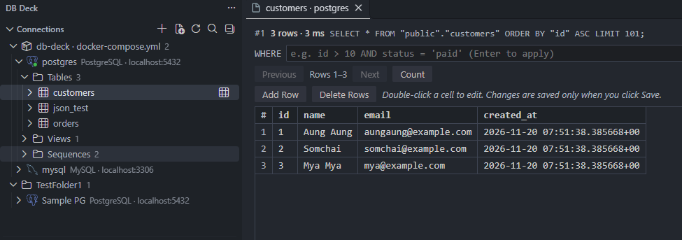
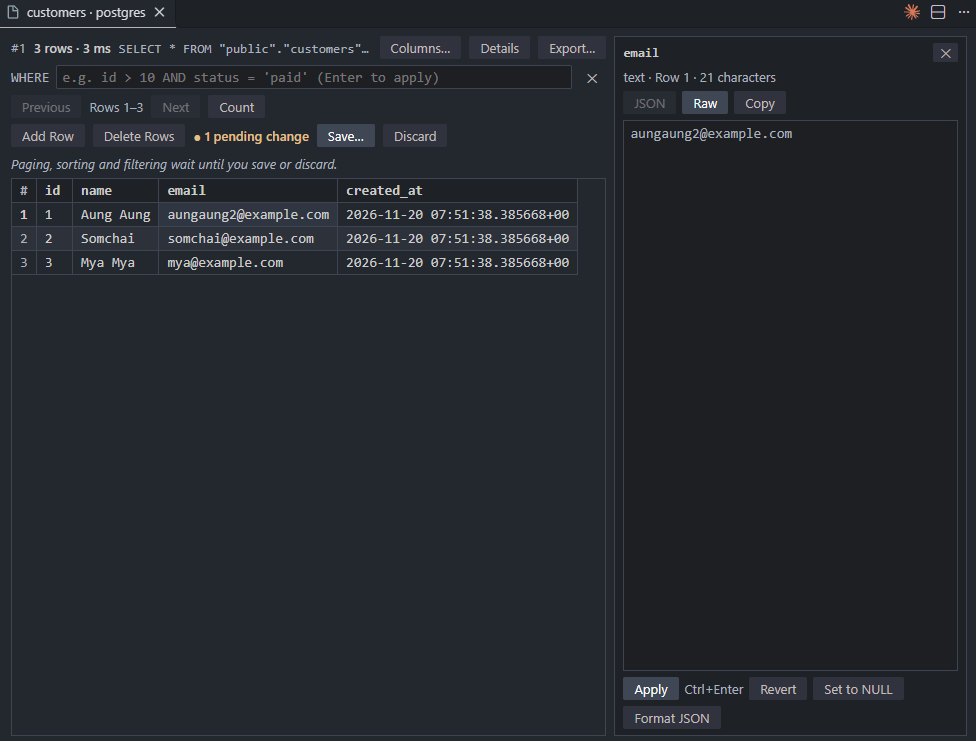
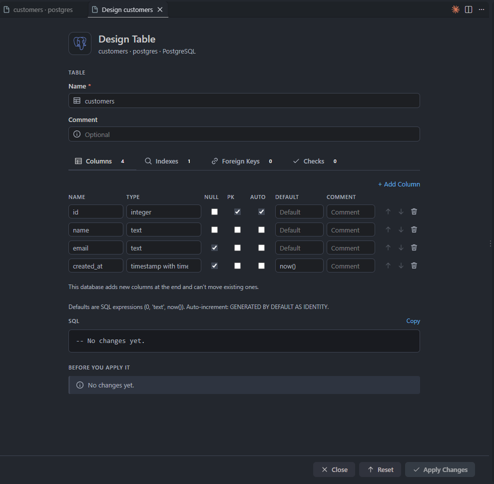
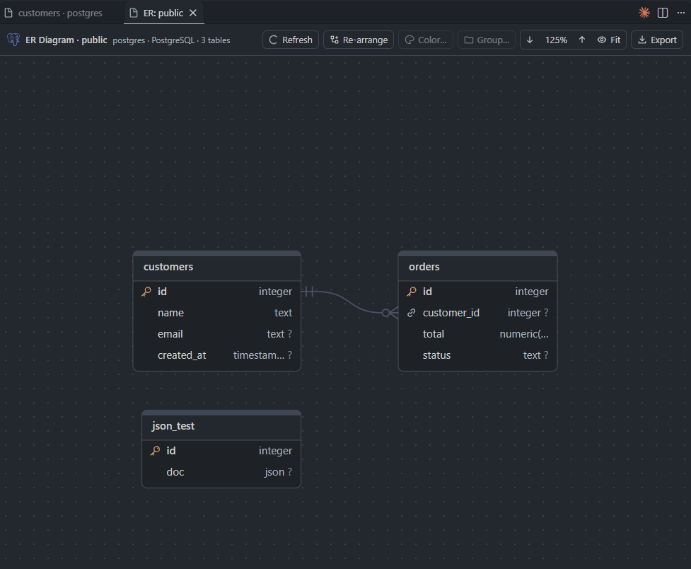

# DB Deck

A free, open-source database client for VS Code. Browse local and remote databases, edit data, design tables and run SQL without leaving the editor.

**SQLite · PostgreSQL · MySQL · MariaDB · SQL Server · Azure SQL** — no native modules, so it runs the same on Windows, macOS, Linux, WSL and remote hosts.

> **Preview:** DB Deck is new. It's used daily, but expect rough edges; please [report what you find](https://github.com/kyawsuthway-dev/db-deck/issues).

## Features

### Connections

- **Connections sidebar** — the database icon in the activity bar lists your connections, with each database's logo and a green dot while connected. Group them in **folders** (Move to Folder…).
- **Connection form** — database type, name and folder; host, port, user, password, database and SSL (or the file for SQLite). Paste a connection string such as `postgres://user@host:5432/db`, or a SQL Server one from the Azure portal (`Server=tcp:…;Database=…`), to fill it in. **Save** tests the connection first and offers **Save Anyway** if that fails, and **Trust Server Certificate** when it failed on a self-signed certificate. Saved passwords are never shown: leave a password field empty to keep it.
- **SQL Server and Azure SQL** — a user and password, or for Azure SQL **Microsoft Entra ID** through the Microsoft account you're signed in to in VS Code, or Azure's default credentials (Azure CLI, environment, managed identity). Named instances (`SQLEXPRESS`) through the **Instance** field. Encrypted by default.
- **SSH tunnel** — reach PostgreSQL, MySQL or SQL Server through an SSH host, with a password or a private key file. The first time, DB Deck shows the host key's fingerprint and asks you to trust it, then warns if it changes.
- **Read-only connections** — the database session is read-only and editing is off (SQL Server has no read-only session, so DB Deck checks each statement and runs only reading ones). The connection shows a 🔒.
- **This workspace only** — set **Available in** to **This workspace** to keep a connection with the current folder, stored privately in VS Code (never in your project files).
- **Connections from `.env`** — DB Deck reads the `.env` at the root of each workspace folder and shows its database with no setup: Laravel's `DB_CONNECTION` (including `sqlsrv`), `DB_HOST`, `DB_PORT`, `DB_DATABASE`, `DB_USERNAME`, `DB_PASSWORD` (and `DB_URL`), and `DATABASE_URL` (`postgres://`, `mysql://`, `mariadb://`, `sqlserver://`, or SQLite as `file:./dev.db` / `sqlite:///path`). They follow the file live. Right-click for **Open Source File**, **Save as Connection…** or **Toggle Read-only**.
- **Docker projects** (such as Laravel Sail) — when `DB_HOST` is a service in the project's `compose.yaml` / `docker-compose.yml`, DB Deck connects to the port Docker publishes on your machine. Database services that only the compose file describes (a `postgres`, `mysql`, `mariadb` or `mcr.microsoft.com/mssql/server` image, or a variant such as `pgvector`, with a published port) show up too, with credentials from the service's `environment`.

### Browsing

- **Schema tree** — PostgreSQL and SQL Server: database → **Schemas** → each schema; MySQL / MariaDB: each database on the server. Every schema has Tables, Views, Functions, Procedures and Sequences (where the database has them). System schemas (`pg_catalog`, `information_schema`, `mysql`, `sys`, …) are listed last and are read-only. Tables expand to columns (type and 🔑 primary key), **Indexes** and **Triggers**.
- **Show DDL** for any object, in a new SQL editor. PostgreSQL and SQL Server table and sequence DDL is rebuilt from the catalog and says what it leaves out.
- **Generate SQL** — SELECT, INSERT, UPDATE or DELETE for a table, opened in an editor and never run for you. Run unedited it can't change rows: UPDATE and DELETE start with `WHERE <key> = NULL`.
- **Find Object…** (🔍 in the Connections view) searches your open connections and reveals the object in the tree.
- **Copy Name / Copy Qualified Name**, quoted only when needed. **Switch Database…** reconnects a PostgreSQL, MySQL or SQL Server connection to another database.

### Table data

- **Rows** — click a table to see 100 rows per page, ordered by primary key. **Previous** / **Next** page through; click a column header to sort.
- **WHERE filter** — type a SQL condition such as `total > 100 OR status IS NULL` above the rows and press **Enter** (**Escape** clears it). Column names with their types and operators are suggested as you type.
- **Count** runs `SELECT COUNT(*)` with your filter: "Rows 1–100 of 12,345".
- **Edit** — in a table with a primary key, double-click a cell (or **Enter** / **F2**), **Add Row**, **Delete Rows**, **Set to NULL** (**Ctrl+0**). Changes stay marked until **Save…** shows a confirmation (with **Review SQL**) and **Apply** runs them in one transaction. If someone changed one of those rows meanwhile, nothing is saved.
- **Value details** (**Details** or **F4**) — the selected cell's full value beside the grid. JSON can be shown indented without changing a single value; edit long values there in editable tables.
- **Hide columns** from the header's right-click menu or **Columns…**; remembered per table.
- **Copy** — select cells, ranges or rows (**Ctrl+A** for all) and **Ctrl+C** for tab-separated text, or right-click for **Copy with Headers**, **Copy as CSV**, **Copy as JSON**.
- **Export…** a result as CSV, JSON or SQL INSERT statements; for tables, the current page or every row matching the filter.

### SQL editor

- **New Query** opens a SQL editor tied to a connection (shown in the status bar; click it to change). **Ctrl+Enter** (**Cmd+Enter**) runs the selection or the statement at the cursor, **▶ Run** above a statement runs that one, and **Run All** (**Ctrl+Shift+Enter**) runs everything. Each statement gets its own result. On SQL Server each `GO` batch runs as one request (so `DECLARE` variables and temp tables work), `GO 5` runs it five times, and `PRINT` messages show with the results.
- **Autocomplete** for tables, columns (also after an alias like `o.`) and keywords, once the connection is open. Typing never connects.
- **Format SQL** (**Shift+Alt+F**) in the editor's database dialect; only spacing and line breaks change.
- **Query History** view — every run from a SQL editor, per workspace and grouped by day, with connection, time, duration and ✓ / ✗. Open, **Run Again**, **Copy SQL**, search or clear.
- **Saved Queries** view — **Save Query…** (or **Ctrl+S** in a New Query editor) keeps a query as a `.sql` file under its connection, available in every workspace.

### Table design

- **New Table…** and **Design Table…** open the Table Designer: columns (types suggested for your database, nullable, primary key, auto-increment, default, comment), indexes, foreign keys and checks. The exact SQL is shown as you edit, with warnings for what can lose data. **Design Table** checks the table hasn't changed since you opened it, then applies everything in one transaction (SQLite rebuilds the table when ALTER TABLE can't, keeping its rows, indexes and triggers).
- **Rename Table…**, **Truncate Table…** and **Drop…** — Truncate and Drop say what will happen and ask you to type the name first. DB Deck never adds `CASCADE`.

### Data transfer

- **Dump to SQL File…** — structure and/or data for the tables and views you tick, restorable with Run SQL File (foreign keys, sequences and auto-increment counters handled per database; binary data in full).
- **Run SQL File…** — right-click a `.sql` file: the form shows what will happen, then runs it in one transaction on its own connection with progress and Cancel. If a statement fails nothing is kept, and **Show Line** takes you there.
- **Import CSV…** — from a table, or a `.csv` / `.tsv` file in the Explorer. Pick the delimiter and header row, map columns (matched by name) in a preview, and import in one transaction. A failing row names its CSV line and nothing is kept. **Delete existing rows first** replaces the table's rows in the same transaction.

### Tools

- **ER Diagram** — a schema's tables as cards joined by curved lines from each foreign-key column to the column it references, with crow's-foot ends. Laid out automatically, then drag to arrange: the layout is saved per connection and schema. Color table headers, group tables, highlight a table's relationships, and export as SVG or PNG.
- **Compare Structure…** — compare a schema's tables with another schema of the same database type (another server, database or schema). Tick the changes to sync (drops start unticked), pair renamed columns so data is kept, see the SQL, then **Open in Editor** or **Apply** on the target after a re-check.
- **Generate Mock Data…** — a generator per column, picked from its name and type (names, emails, addresses, UUIDs, numbers and dates in a range, enum and `CHECK … IN` values…). Foreign keys use existing parent rows, unique columns stay unique, and a seed makes rows repeatable. The preview shows the first rows exactly as they'll be inserted; up to 10,000 rows in one transaction.
- **Explain** — right-click in a SQL editor, or **Explain** above a statement: the plan as a tree with cost bars, row estimates and hints, without running it. **Explain Analyze** (PostgreSQL, MySQL 8; SQL Server shows the estimated plan only) measures real times for reading statements only, in a read-only transaction that is rolled back.
- **Server…** — status (version, uptime, size, connections, cache hit ratio…), processes with **Cancel Query** / **End Session** (each asks first; off on read-only connections; SQL Server has End Session only) and searchable server settings.

## Getting started

1. Install **DB Deck** from the Extensions view (search for "DB Deck"), or a `.vsix` with **Extensions: Install from VSIX…**.
2. Click the **database icon** in the activity bar, then **Add Connection**.
3. Choose the database type, fill in the details and **Save**.
4. Expand the connection to browse; click a table to see its rows.
5. Expand a connection and click **New Query** on its database (on a SQLite connection: the connection itself), write SQL, and press **Ctrl+Enter** (**Cmd+Enter** on macOS).

| Command | Where |
| --- | --- |
| Add Connection | Connections view toolbar, Command Palette |
| New Query | Connections toolbar; hover a database (a SQLite connection); right-click a connection, database or table |
| Open Query… (a saved query) | Hover or right-click a database |
| Run Query (selection or statement at cursor) | `Ctrl+Enter` / `Cmd+Enter` in a SQL editor, **▶ Run** above a statement |
| Run All | `Ctrl+Shift+Enter` / `Cmd+Shift+Enter`, ▶ in the editor title |
| Select Connection for This Editor | Status bar, Command Palette |
| Save Query… | Bookmark icon in a SQL editor's title bar, right-click in a SQL editor, `Ctrl+S` / `Cmd+S` in a New Query editor |
| Find Object… | Connections view toolbar, Command Palette |
| Edit Connection… / Move to Folder… / Switch Database… / Server… / Remove Connection | Right-click a connection |
| Design Table… / Import CSV… / Generate Mock Data… / Dump to SQL File… / Show DDL / Generate SQL | Right-click a table |
| ER Diagram / Compare Structure… / New Table… | Right-click a connection or schema |

All commands are in the Command Palette under **DB Deck**.

## Settings

| Setting | Default | |
| --- | --- | --- |
| `dbDeck.history.enabled` | `true` | Record queries run from SQL editors in the Query History view (per workspace, the 1,000 newest). Turning it off stops recording; **Clear Query History** removes what's there. |
| `dbDeck.envFiles` | `[".env"]` | Files at the root of each workspace folder read for database connections, for example `[".env", ".env.local"]`. An empty list turns this off. |

## Privacy and security

- **No telemetry.** DB Deck only talks to the databases (and SSH hosts) you configure.
- **Passwords** — database passwords, SSH passwords and key passphrases are stored only in VS Code's SecretStorage (your OS keychain), never in settings files. `.env` and compose passwords are read when connecting and kept only in memory. Private key files are read when connecting and never copied.
- **Writes happen only when you ask.** Browsing, previews and metadata only read. DB Deck writes when you run SQL that does, or when you confirm in a form: **Apply** for table edits and designs, **Run** for a SQL file, **Import**, **Insert** for mock data, **Create Table**, **Apply** in Compare Structure, or after typing a table's name for Truncate and Drop. Read-only connections refuse all of these.
- **Query history** stores the SQL you run exactly as typed, in VS Code's local workspace storage, so it can include values you typed. It never leaves your machine; turn it off with `dbDeck.history.enabled`.
- **Read-only** is a guard against mistakes, not a security boundary (see below). For a real guarantee, connect as a database user that can't write.

## Known limitations

### General

- Results keep up to 10,000 rows per statement. A larger result is still read to the end (the rows past the limit are dropped as they arrive), so it takes as long as the whole query.
- **SQLite** runs in WebAssembly on an in-memory copy of the file. The file is reloaded when it changes on disk and written back after each run that might change it. A transaction left open at the end of a run is not kept open.
- **PostgreSQL and MySQL** keep one connection open per saved connection, so `BEGIN` … `COMMIT` across several runs works. **PostgreSQL** objects need PostgreSQL 12 or newer; functions that belong to an extension (such as `pgcrypto`) aren't listed.
- **Read-only:** PostgreSQL and MySQL start each session read-only, but SQL can turn that off again (`SET`, `BEGIN READ WRITE`, `START TRANSACTION READ WRITE`), and the database decides what functions with side effects may do. SQLite runs with `PRAGMA query_only` and never writes the file back.
- **SQL Server** needs SQL Server 2017 or newer, or Azure SQL Database (Azure SQL Managed Instance should work but isn't tested). Values are shown exactly as SQL Server stores them, including `decimal(38,…)`, `money`, `datetime2(7)` and `datetimeoffset` with its offset. **Read-only** SQL Server connections run only statements DB Deck recognizes as reading (SELECT, WITH, DECLARE, SET, PRINT, IF / WHILE blocks): `EXEC` and anything that may write is refused before it's sent. A function can't write in SQL Server, but this is still a guard against mistakes, not a security boundary.
- **Microsoft Entra ID** sign-in (Azure SQL) is new and hasn't been tested against every Azure setup yet: please [report](https://github.com/kyawsuthway-dev/db-deck/issues) what doesn't work. Windows (NTLM) and Kerberos sign-in aren't supported yet.
- **Switch Database…** reconnects, so it asks first when the connection is open: an open transaction ends.

### Connections

- Encrypted connections: **SSL** verifies the certificate; **SSL, allow self-signed** doesn't.
- **SSH tunnels** use one SSH session per connection and a channel per database connection; no local port is opened. SSL still checks the certificate against the database host you entered. SSH agents, jump hosts and `~/.ssh/config` aren't supported yet. A SQL Server **named instance** is found through SQL Browser, which doesn't work through an SSH tunnel: use the instance's port instead.
- **`.env` connections** — only the root of each workspace folder is read, and only in trusted workspaces. If an open connection's settings change, DB Deck disconnects it and tells you. SQLite paths are relative to the `.env` folder (for `file:` URLs, the `prisma/` folder first). `${VAR}` references are expanded; a bare `$` is kept as written.
- **Docker** — the compose file must publish the database port (`ports:`); its variables are filled from the same `.env`, not your shell. DB Deck only reads the compose file and never runs `docker`: if a container isn't running, connecting fails with a hint to start it. Docker secrets (`*_FILE`), `env_file:` and images with their own variable names (such as Bitnami's) aren't read.

### SQL editor

- MySQL `DELIMITER` scripts aren't supported yet, for running or formatting (Run SQL File says so instead of running them). MySQL function, procedure and trigger DDL is shown for reading; running it needs a client that supports `DELIMITER`.
- **Keyboard shortcuts** (**Ctrl+Enter**, **Ctrl+Shift+Enter**, and **Ctrl+S** in a New Query editor) apply only in SQL editors linked to a DB Deck connection. If another extension also uses **Ctrl+Enter** in the same editor, change one in **Keyboard Shortcuts** (search for `dbDeck.runQuery`), or use the ▶ buttons.
- **Autocomplete** reads the tables in the current statement without running anything. After changing the schema outside DB Deck, **Refresh** the connection to update the suggestions.
- **Query history** keeps the 1,000 newest runs per workspace (fewer when queries are very long). SQL over 100,000 characters is kept shortened and can't be run again from history. Table views, paging and filters aren't recorded.
- **Saved queries** live in DB Deck's own storage folder, not in your project, so they aren't committed or synced by Settings Sync. Removing a connection keeps its saved queries and history, marked as belonging to a removed connection.

### Table data

- The **WHERE** filter is plain SQL for your database, with its rules (for example, `LIKE` is case-sensitive in PostgreSQL; use `ILIKE`). It must be a single condition: anything after a `;` is rejected, not run.
- **Editing** needs a primary key; views, tables without one and binary columns are read-only. Values are typed as text and the database converts them; an empty cell is an empty string (use **Set to NULL** for NULL). Saving uses its own short connection, so a transaction left open in a query editor isn't affected. Unsaved edits are lost if you close the Results tab.
- The save conflict check compares the cells you edited with what was loaded, except `float` / `double` / `real` columns (still matched by primary key); `json` columns are compared by their text. MySQL normalises `JSON` when storing it (`1.10` becomes `1.1`), so that's what DB Deck shows. MyISAM tables have no transactions, so a failed save there may be partly applied.
- **Export and copy** write values exactly as shown. NULL is an empty field in CSV and copied text (an empty string is `""`), and `null` in JSON. JSON values stay text, so large numbers keep every digit. CSV files start with a UTF-8 byte order mark for Excel. Binary columns export as the shortened hex the grid shows. MySQL INSERT statements escape backslashes, which is wrong with `NO_BACKSLASH_ESCAPES`. Values starting with `=`, `+`, `-` or `@` are kept as they are: be careful opening exports of untrusted data in a spreadsheet. Exporting all rows of a table with no primary key and no sort may repeat or skip rows. Hidden columns aren't exported.

### Table design and data transfer

- **Table design** sends defaults, types and CHECK conditions as you typed them (each must be one SQL fragment, no `;`). PostgreSQL type changes use `USING column::type`, and PostgreSQL can't reorder columns (new ones go at the end). Indexes on expressions and partial indexes aren't shown in the designer and are left as they are (SQLite keeps them through a rebuild). SQLite can't rebuild tables with generated columns yet, has no TRUNCATE (DB Deck runs `DELETE FROM`) and doesn't enforce foreign keys unless the database turns them on.
- **MySQL** commits each CREATE / ALTER / DROP / TRUNCATE on its own, so those can't be rolled back: a failing script or sync keeps everything up to its last schema change (the forms say so). PostgreSQL, SQL Server and SQLite roll everything back.
- **SQL Server table design** names new default constraints `DF_<table>_<column>` and drops and re-adds a column's default around type or nullability changes. SQL Server can't turn IDENTITY on or off for an existing column (the designer says so), and refuses to change a column that's in an index or the primary key. Descending, filtered, columnstore and included-column indexes aren't shown in the designer and are left as they are. Table and column comments aren't supported for SQL Server yet.
- **Dumps** are portable SQL for moving data, not a full backup: functions, procedures, triggers, users, permissions and server settings aren't included (the file says so). Restore into an empty database. MySQL views lose their `DEFINER` and source-database prefix; views that depend on other views may need reordering.
- **Run SQL File** runs the file as saved; a file with its own `BEGIN` / `COMMIT` runs as written, without DB Deck's transaction. SQL Server files run one `GO` batch at a time (the form counts batches as statements). SQL Server dumps use `GO` between batches, so they also run in `sqlcmd` and SSMS.
- **Import CSV** reads UTF-8 files only. Values are sent as text for the database to convert, so dates and numbers must be in formats it accepts. Rows with a different number of fields than the header stop the import before anything is written. Binary and generated columns can't be filled. **Delete existing rows first** uses `DELETE`, so `ON DELETE CASCADE` foreign keys delete rows in other tables too. On SQL Server, mapping a column to an IDENTITY column inserts the file's values (`IDENTITY_INSERT`); skip it to let the server number the rows.

### Tools

- **ER diagram** layouts are kept in VS Code's own storage per connection, database and schema, never in your project; removing a connection removes them. Views aren't drawn, and foreign keys to another schema end in a label.
- **Compare Structure** compares tables only (columns, primary keys, indexes, foreign keys, checks, comments), not views, functions, triggers, table options or data. Server-generated index, foreign key and check names count as the same when the definitions match. Type spellings must match exactly (`int(11)` and `int` differ). Generated columns, expression or partial indexes and triggers aren't compared.
- **Generate Mock Data** fills one table at a time (add parent rows first), in English only. Binary, array and spatial columns aren't generated, and CHECK constraints other than simple `IN` lists aren't evaluated. Foreign keys pick from the first 10,000 parent rows; unique columns are checked against the first 100,000 existing values.
- **Explain Analyze** runs on its own connection, so temporary tables and `SET` from your editor's session aren't there. It isn't available for SQLite or MariaDB, and older MySQL / MariaDB show the tabular EXPLAIN as a flat list. Cancel Query and End Session need the database's permission (PostgreSQL: your own sessions or `pg_signal_backend`; MySQL: your own or `CONNECTION_ADMIN`; SQL Server: `ALTER ANY CONNECTION` to end other sessions). SQL Server can't cancel another session's query, only end the session. Some SQL Server status values and the processes' running statements need `VIEW SERVER STATE` (Azure SQL: `VIEW DATABASE STATE`); without it they show "n/a" with the reason.

## Contributing

Contributions are welcome. You only need Docker, [Task](https://taskfile.dev) and VS Code — no local Node.js. See [CONTRIBUTING.md](CONTRIBUTING.md) to get set up in one command (`task setup`).

## License

[MIT](LICENSE). DB Deck bundles open-source libraries listed with their licenses in [THIRD_PARTY_NOTICES.md](THIRD_PARTY_NOTICES.md).
